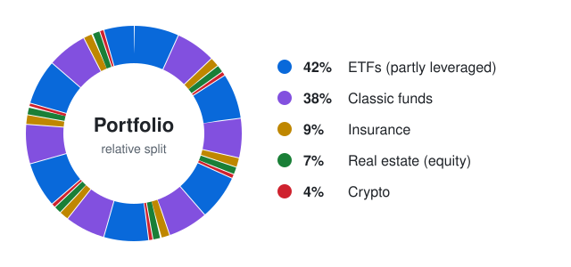
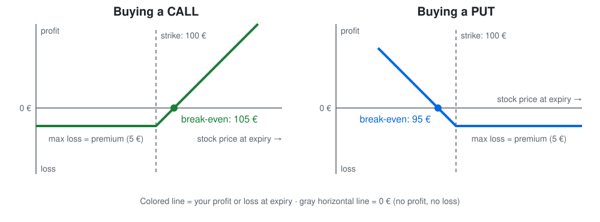
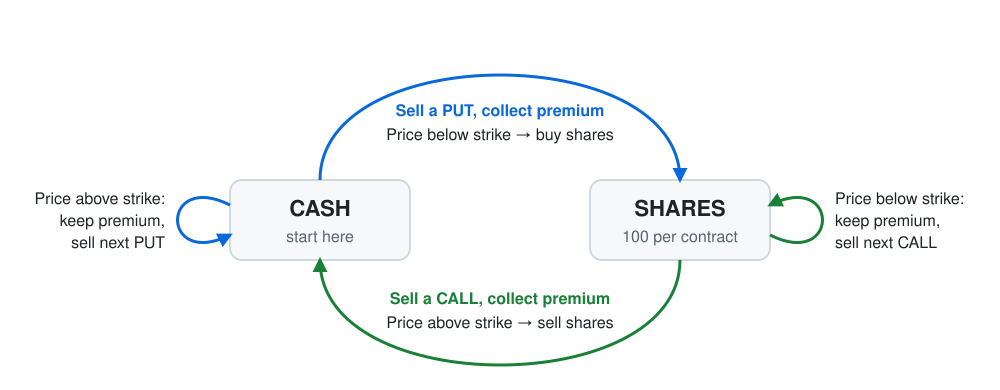

# 2026-W42: The Wheel (Investment)

*Published: 2026-10-16*

## Intro

I've been interested in finance since 12th grade. In school I had to write a seminar paper (Seminararbeit) about chart patterns in the stock market. Well, that was actually my second topic. My first one was differential equations, but I had some differences with my teacher and got kicked out. From today's perspective that was a good deal: differential equations came up a lot in my physics studies anyway, so I learned them regardless, and I got an early taste of investing. It seems that was the natural trigger for me. I took some online trading courses with simulated money, got really interested and soon opened my first real trading account at Consorsbank. Unfortunately, I was very limited in time and money during my studies, so I didn't trade that much. And it was only a first taste: today my portfolio is much broader than single stocks. I've gained a lot of knowledge and I'm still learning.

There is a lot I could write about, but in this post I'd like to cover a new discovery called the wheel. It was a lucky moment: I was discussing investments with AI and finally arrived at that idea. Right when I thought I knew something about investing, a completely new idea came up.

You probably know the story of the goose that lays golden eggs. Most of my portfolio is about growing the goose: buy, hold, let it get bigger. What I wanted was to raise a new goose, one that lays eggs on a regular basis. The wheel might be exactly that.

I'll start this post with my current financial situation and where I'm invested right now. Then I cover some option basics you need to understand the wheel, and finish with some closing words.

## Current Finances

Here I count my wife and me together. I'll only share relative numbers, no absolute ones.

- **ETFs (~42%)**: World and tech ETFs (some ETNs). Partly leveraged: mostly 1x, but also 2x and 3x and even a small part in 5x. On average probably around 2x.
- **Classic funds (~38%)**
- **Insurance (~9%)**: Policies partly invested in funds and/or ETFs
- **Real estate (~7%)**: Our equity in one property. About 70% of the purchase price is still financed by a loan.
- **Crypto (~4%)**: Most of it in crypto lending on Nexo

## Basics

What are options?

An option is a contract that gives the buyer the **right, but not the obligation**, to buy or sell a stock at a fixed price (the **strike**) at or until a fixed date (the **expiry**). For this right, the buyer pays a fee to the seller, the **premium**. One standard contract usually covers 100 shares.

- **CALL**: Right to **buy** a stock at the strike price. Pays off for the buyer if the price rises above the strike (plus the premium).
- **PUT**: Right to **sell** a stock at the strike price. Pays off for the buyer if the price falls below the strike (minus the premium).

Example: a stock costs 100 €, I buy a CALL with a strike of 100 € and pay 5 € premium. If the price ends at 90 €, I don't use the option (the market is cheaper) and lose the 5 €. At 102 €, using the option is already cheaper than the market, but I'm still at -3 €, because the premium is gone anyway. At 105 € I'm at break-even, and at 120 € I'm at +15 €. The PUT works the other way around: it starts paying off below the strike, and from 95 € down I'm in profit.

As a buyer, the most you can lose is the premium. For the seller, it's exactly the other way around: the premium is the maximum gain, but if the buyer exercises the option, the seller has to sell (CALL) or buy (PUT) the shares at the strike price. And that's the side the wheel is about.

## The Wheel

The idea of the wheel is that we don't compete or speculate with options. Instead, we offer options to other people and get a fee for it. That's the basic, simple idea: just grab the fee.

As stated above, the idea grew while I was discussing with AI and learned about lending out your stocks. My initial idea was to buy some solid stocks, lend them out and get some extra fee. It turned out that with stable, solid stocks you don't get a high fee for lending. But if you offer options on your stocks, you do get a good fee, with the risk of losing your stocks if the CALL gets exercised.

So I got interested, looked a bit further and finally arrived at the neat idea of the wheel. It starts when you only have money and no stocks:

1. **Sell a PUT.** I offer someone to buy their stock at a fixed price in the future, if the price falls below that strike. For this I get the premium. If the price stays above the strike, all right: I keep the fee and go for the next PUT.
2. **Get the shares.** This continues until the price falls below the strike and the shares get put on my desk. Now I have some stock.
3. **Sell a CALL.** So what should I do with the stock? I say: OK, let's sell it to someone, but only above a certain price. So I offer a CALL and again get a premium. If the price stays below the strike, I keep my stock and offer the next CALL.
4. **Sell the shares.** At some point the price rises above the strike and the shares get called away. Now I have money again and start from the beginning.

Of course, I still go through the turbulence of the stock. The premiums cushion it a bit, but if the stock crashes, I carry almost the full loss, just like any other shareholder. The difference is that I live more off the fees from the PUT and CALL options. And the catch: my winnings are capped at the top, because if the stock skyrockets, I still have to sell at the strike. But in the end, I think it's a great approach and adds a different kind of income to my portfolio. It's still the stock market, though.

## Closing Words

So where am I at the moment? I haven't started yet. I just got the idea and wanted to share it. Most likely, I'll take it slow: collect some money from my regular income and start investing around Christmas, when I have enough time for stuff like that. Since one contract usually covers 100 shares, I need enough cash to buy 100 shares at the strike price, so saving up first makes sense anyway. I'll give an update once I've gained some experience and compare it to my other investments.

*This is not financial advice, just me sharing what I'm learning.*
