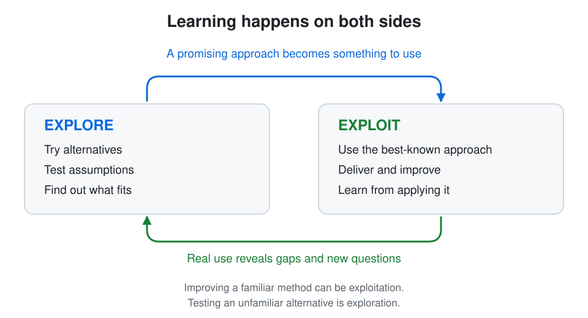

# 2026-W43: Explore vs. Exploit

*Published: 2026-10-23*

## Intro

I've had this idea in the back of my head for a while, probably because of my machine learning background. Starting at a new company has made it concrete. I'm still an AI Solution Architect, but the company is bigger, things work differently, and the environment is more regulated than the start-up culture I came from. I want to deliver while figuring out which parts of my experience transfer. That brings me to **exploration vs. exploitation**: we often see the successful application, while the difficult search behind it stays mostly invisible.

## Explore, Exploit, Repeat

In reinforcement learning, an agent learns from interacting with an environment. It can **exploit**, choosing what looks best based on existing knowledge, or **explore**, trying alternatives to discover something better. A simple approach is *epsilon-greedy*: usually choose the best-known action, occasionally a random one. Only exploiting risks missing better options; constant exploration leaves little room to use what has been learned. Exploitation can still pursue long-term rewards: it uses the best option currently known.

Learning happens on both sides. Improving a familiar method can be exploitation; testing an unfamiliar alternative is closer to exploration. Applying what we know also reveals what we don't know yet, so we don't need to finish exploring before we start delivering.

## The Part We See

When someone has a working system, we see them delivering solutions or running a business. The discarded approaches are less visible and can look like wasted time. Yet finding what works can be the harder part: applying a known approach may be straightforward, while searching means making decisions without a reliable recipe. Copying someone's visible routine can miss the experience that makes it work.

Bill Gates [said in 2016](https://www.seattletimes.com/nation-world/move-over-oprah-its-the-bill-gates-book-blog/) that he reads about 50 books a year. We see Microsoft and a successful founder, but the time spent learning is less visible. Reading isn't always exploration, and that habit alone doesn't explain Microsoft's success. It does illustrate the investment in ideas beyond the visible business.

Kahneman's *Thinking, Fast and Slow* offers another analogy: **System 1** is fast and automatic; **System 2** is deliberate and effortful. Practiced skills can run largely on System 1, while unfamiliar options often demand System 2. It isn't an exact match: a difficult calculation using a known method still needs conscious effort, and intuition can suggest new directions. When we're still figuring out an approach, we often can't rely on routine: we have to compare options and question assumptions consciously. That sustained System 2 effort can be exhausting even before it produces a visible result.

## Different Work, Different Mixes

Right now, I'd estimate that **30–50% of my working time goes into exploration**, sometimes more. A researcher tackling open questions might spend a larger share searching; a tradesperson doing familiar jobs might spend more time applying a proven craft. Both need the other side, and the balance changes with the task and experience.

The chart sketches those differences. **The other roles use invented, illustrative ranges, not measured occupational averages.** Bars show range midpoints; whiskers show the assumed spans, not statistical confidence intervals. For simplicity, each pair adds up to 100%, although real activities overlap.

## One Last Dinner, or a New City?

The time horizon matters too. Imagine you're leaving a city and have time for one last dinner. A familiar favorite makes sense: discovering a better restaurant leaves little time to benefit. Now imagine you've just moved to a city where you expect to stay for years. Trying places could improve many future evenings, even if some meals disappoint.

This connects to **tactics and strategy**: use what you know for tonight, or accept some disappointments to make better choices later. Strategy also needs exploitation, and tactical experiments can teach us something. But a longer horizon gives exploration more room to pay off. The cost of experimenting, the quality of our current options, and how quickly the environment changes matter too.

## Where Does That Leave Me?

In a new company, what I learn now may help me many times later. But I need to apply it and get feedback, or I could keep preparing without finding out whether it helps. This blog follows that loop: reading gives me ideas, writing exposes gaps, and publishing opens them to other perspectives. The one-hour limit makes me put something out there.

My current takeaway: **give the search enough room, even when its results aren't immediately visible, and keep bringing what I learn back into use.** When someone's work looks easy, we may only be seeing the part after they figured it out. The right balance is still an open question, and one to revisit as I settle into this role.
