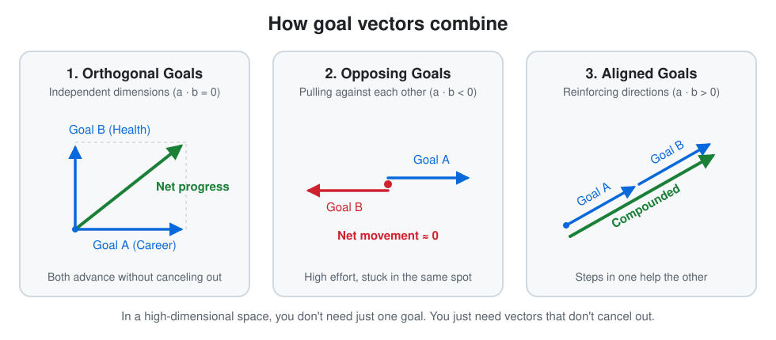
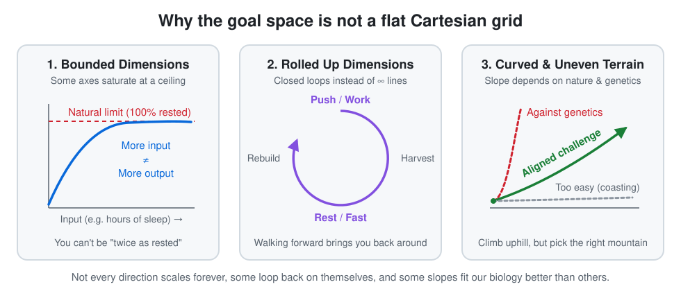

# 2026-W44: Goals as Vectors in a High Dimensional Space

*Published: 2026-10-30*

## Intro

Every year, I write down 20 goals. At the end of the year (or early in the next) I check how many I actually reached. Usually, I end up around 10 out of 20, which I'm quite happy with.

Conventional productivity advice often tells you to pick *one* big goal and drop everything else. That never felt right to me. My list is always a mix: family milestones like a shared vacation or finally making photo books, career targets around salary, role, or shipping concrete ideas, and sports challenges.

Maybe it's my physics background, but I prefer to think of goals as **vectors in a high dimensional space**. You don't live on a single number line. You can move along many dimensions at once, as long as your vectors don't cancel each other out, and as long as you love moving in that direction.

## High Dimensional Space: Why We Can Have Many Goals

If life were one dimensional, every step toward one goal would be a step away from another. In a high dimensional space, many axes are largely **orthogonal** (independent). Making a family photo book on a Sunday afternoon doesn't undo a productive week as an AI Solution Architect, and practicing a handstand for five minutes doesn't shrink my investment portfolio.

Where people get stuck is when they pick **opposing vectors** (where the dot product is negative), or overload a shared bottleneck dimension like time, sleep, or recovery. For example, trying to run an extreme calorie deficit while chasing personal records in endurance training pulls the body in opposite directions. Lots of effort, almost zero net movement.

Even better is when two goals point in a similar direction and reinforce each other. When improving your fitness gives you more energy at work, or when writing this blog helps me structure thoughts I also need in my job.

## A Vector Is a Direction, Not Just a Point

Thinking in vectors also changes what "missing" a goal means. A vector isn't just a target point in the distance; it has a **direction** and a **magnitude**.

Some goals simply take longer than a single year:
- **The handstand:** I had "learn a freestanding handstand" on my annual list for three years. For two years I failed to check the box, and in the third year it finally clicked. Those first two years weren't zero, they were steps along the axis.
- **The marathon:** This year, I put a marathon on my list. I realized along the way that I wasn't fit enough yet for the full distance, so I ran a half marathon instead. Goal missed on paper, but I moved a huge step in the right direction.

Just as often, walking in a direction teaches me that the original target wasn't even that great, and that's fine. Moving already changed my perspective. That's why I don't believe in blindly locking onto a goal forever. In goal setting research, [Locke and Latham (2002)](https://pubmed.ncbi.nlm.nih.gov/12237980/) showed that specific, challenging goals drive performance, while research by [Wrosch et al. (2003)](https://pubmed.ncbi.nlm.nih.gov/15018681/) highlights that **goal disengagement and reengagement** (knowing when to let go of an outdated goal) is essential for happiness and mental health.

We all know doctors or teachers who chose their path at 19 because it sounded respectable, executed the plan for a decade, and ended up miserable because they never paused to ask if the direction still fit them. Personally, I'm much more of a pirate: I value flexibility and optionality. I'd struggle with a rigid track like civil service teaching (*Lehramt*) where switching course later is really hard.

## Beyond a Flat Grid: Ceilings, Cycles, and Uneven Terrain

Here is the catch with the math analogy: our life space is **not a flat Cartesian grid**. Different dimensions behave very differently.

1. **Bounded dimensions (saturation):** You can't scale every axis to infinity. Once you're well rested after 8 hours of sleep, sleeping 16 hours won't make you "twice as awake." Some dimensions have a natural ceiling; once you're there, maintenance is enough.
2. **Compounding vs. saturating axes (the 1 year vs. 7 year effect):** Alongside my 20 annual goals, I also write down a **7 year vision** of what I want my life to look like. As psychologist Gail Matthews showed experimentally at Dominican University, simply writing goals down significantly increases the odds of achieving them. And across a 7 year horizon, we routinely **overestimate what we can do in 1 year, and underestimate what we can do in 7 years**. On unsaturated axes (like skills, networks, or capital), we grow by ~1% steps rather than fixed amounts: early progress feels slow, but over 7 years compounding takes over until the axis eventually saturates.
3. **Rolled up (cyclical) dimensions:** Like compactified dimensions in physics, some axes loop back on themselves: work and rest, seasons, or fasting and eating. You don't walk to infinity; you move through a healthy cycle.
4. **Uneven terrain and genetics:** Not every direction is equally easy to walk. Some slopes are steep by their very nature, and others are steep for *us* because of our circumstances or genetics. We shouldn't always take the flat, easy path downhill, because growth needs resistance. But we shouldn't stubbornly fight our own biology either. Climb uphill, just pick a mountain that fits how you're built.

## Closing Words

So when I only hit 10 out of 20 goals at the end of the year, I don't see 10 failures. I see 20 vectors that got me moving, a few course corrections where I learned what I actually want, and compounding progress toward the 7 year horizon.

Pick goals that don't pull against each other, check your compass regularly so you don't end up trapped in someone else's dream, and fall in love with walking in that direction. In a way, that makes the old saying true again: **the path really is the goal**, or at least a big part of it. Which makes perfect sense once you see a goal as a vector rather than just a point.

