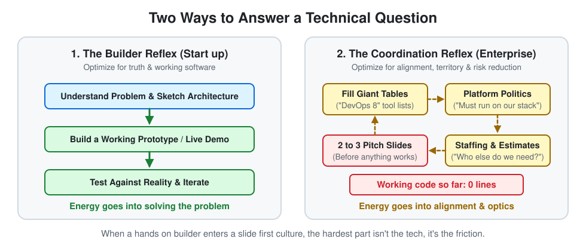

# 2026-W45: Slides vs. Shipping (A Builder in Corporate Land)

*Published: 2026-11-06*

## Intro

Today's post was supposed to be called *"Improve this Blog"*. I had a neat list ready: better landing page, view tracking, maybe a comment section. Instead, I deleted the heading five minutes ago because something else has been sitting on my chest all week.

I started my new job as an AI Solution Architect at a large consultancy at the beginning of October. Before this, I worked in startups and smaller companies. Moving into a big corporate environment was a conscious choice: I wanted to see how large enterprises tick and take a step toward management.

Now, five weeks in, I'm sitting here on a Friday night in a pretty thoughtful and honestly slightly frustrated mood, asking myself a blunt question: **Did I pick the wrong environment for how I'm wired?**

This isn't a polished success story. It's a snapshot from the middle of the culture shock.

## How I'm Wired vs. What I'm Seeing

In smaller companies, my workflow was simple: there is a problem, you sit down, you think it through, you pick the best tools for the job, and you build it. I love building things, and I like building them the way that makes the most technical sense. What I realized this week is how deeply I dislike endless alignment loops and corporate politics.

Right now, my days feel like a collision between a hands on execution mindset and a culture that runs on slides, estimates, and territory defense. Three moments from this week sum it up pretty well.

## 1. The Giant Table vs. The Architecture Sketch

We are preparing an upcoming engagement for a financial institution to build a self hosted CI/CD and container platform on bare metal (Kubernetes or OpenShift, plus the whole surrounding ecosystem). Technically, that's a cool challenge.

We are four people preparing a workshop. We aren't even inside the project yet, so we don't know the exact reality on the ground. How did we start? By spending hours filling out a massive table along the "DevOps 8" loop, listing tools phase by phase. To me, that felt completely backwards. Without an architectural structure, a tool list is just guesswork in a spreadsheet.

So I started drawing the actual architecture. Eventually, we built our structure around that sketch, which felt good, but we still spent hours marching through that endless table instead of diving deeper into the core architectural trade offs and sketching real alternatives. It felt like sitting in an ivory tower, theorizing on paper just to look thorough while completely detached from reality.

## 2. Defending an Unfinished Platform

The second moment was a meeting with an internal platform team. We are supposed to build a showcase on top of their platform. When you look under the hood, though, the platform simply isn't ready for what our showcase needs.

My pragmatic builder suggestion was: let's only use the parts of the platform that actually work today, connect via clean APIs, and build the rest around it so the showcase actually flies.

Even though everyone in the room could see the gaps, the platform team defended their system tooth and nail. It *had* to be done on the platform. In the end, we found a workable compromise together with my boss: we will build the missing pieces as new services and integrate them *into* their platform. I can live with that technically, and politically everyone saves face. Still, it was eye opening how fiercely people defend a platform's territory even when the tech clearly isn't there yet.

## 3. "Can You Put That on 2 to 3 Slides?"

The third meeting hit closest to home. For the past two weeks, I've been wrestling with our internal AI development backbone. It's essentially a spec driven process layer on top of a coding harness that doesn't just write snippets, but plans features end to end from specs to test coverage and production rollout. It's genuinely cool technology, and clients are interested.

After two weeks of digging through it, I finally got the hang of it. In fact, I probably understand how it actually works under the hood better than most people around me. So my natural conclusion was: **great, let me build something real with it and turn that into a live demo.**

Apparently, I misunderstood the game. The question in the meeting wasn't *"What did you build?"*. It was: *"How quickly can we put together a demo pitch (meaning slides), how much effort do we estimate, and who else do we need to pull in?"*

I sat there thinking: *Why don't we just build the demo?* Why pull in more people who haven't wrestled with the tool, who will only add another layer of half truths and buzzwords that confuse everyone? I already have my hands in the engine. Just let me build it.

## The Management Dilemma: To Delegate or Not to Delegate?

Of course, this forces me to look in the mirror too. I wanted to move closer to management. And management is supposed to be about delegating, estimating, and aligning, not doing everything yourself in a dark room.

Maybe part of the friction is on me. Maybe I need to let go of the keyboard more often.

**But here is my counter thought:** Can you really delegate something that is still in the raw exploration phase when nobody around you has deeply understood it yet? If you delegate something well known, you get leverage. If you delegate something new before anyone has built a working mental model, you don't get leverage. You get slide decks full of buzzwords and a game of broken telephone.

There is a deeper structural issue underneath this too: **there are simply too few true techies in management.** Many decision makers hear the AI buzzwords, nod along, and repeat them, but they don't truly grasp what happens under the hood or what follows from it. They still think in old org chart reflexes where building something serious requires staffing a team of ten developers, writing estimates, and managing handoffs. They don't see that modern AI tooling implies a much flatter structure: one capable builder who deeply understands the stack can now build almost endlessly on their own, turning ideas into working reality in the time it takes a committee to agree on three slides.

At the same time, I see a massive opportunity for the company right here. If a large consultancy actually embraces this shift, it can move faster and deliver more real value than ever before. But capturing that opportunity requires a real change in thinking and acting, not just new slide templates. In the long run, organizations and roles that refuse to adapt to this new reality will simply become obsolete and get left behind.

## Closing Words

So where does that leave me after five weeks? Honestly, I don't have a neat resolution yet. The cup hasn't overflowed, and maybe this is exactly the friction I signed up for when I said I wanted to experience a large enterprise from the inside.

Back in [W43](2026-w43.md) I wrote about giving exploration time, and in [W44](2026-w44.md) about checking whether your vectors still point in the right direction. Right now, the terrain feels steep and full of political headwind. Maybe the real opportunity is to become one of those rare technical voices in management who actually understands what a small, flat team with AI leverage can do. Or maybe I'll realize down the road that I'm too much of a pirate for slide driven architecture.

For tonight, I just needed to write this down instead of pretending everything is a smooth success story. Let's see how the vector looks a few weeks from now.

