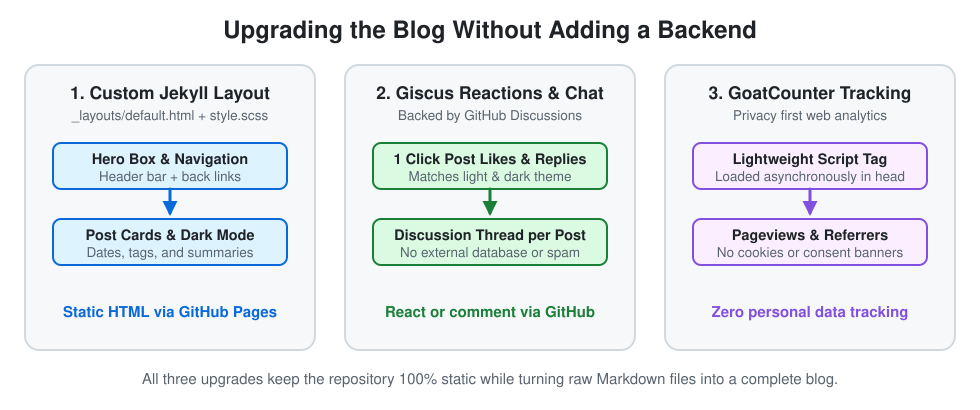

# 2026-W46: Improving This Blog in 60 Minutes

*Published: 2026-11-13*

## Intro

Last week I scrapped my original plan for [W45](2026-w45.md) because I needed to get some thoughts about corporate life off my chest. Today I am back to the original plan: taking my 60 minute Friday slot to actually upgrade this blog and write the post about it at the same time.

Up to now, this blog was essentially a raw GitHub repository rendered with the default Primer theme. That was great for getting started in [W41](2026-w41.md) without procrastinating, because shipping beats polishing forever. Still, after five weeks of writing, a few basic pieces were missing:

1. **A proper landing page and navigation** instead of a bare bullet list
2. **A comment section** so readers can actually reply right below a post
3. **Privacy friendly view tracking** to see if anyone out there is reading along

My goal for today was to add all three within a single hour without introducing a backend server, a database, or annoying cookie banners.

## 1. A Better Landing Page and Post Layout

Until today, the front page was just a raw `README.md` with five bullet points, and once you clicked into a post, there wasn't even a button to get back to the overview.

Because GitHub Pages runs on Jekyll under the hood, you don't have to throw away the simplicity of Markdown files to get a custom look. By adding a custom `_layouts/default.html` template and extending `assets/css/style.scss`, we replaced the bare repository wrapper with a real blog layout:

- **Top navigation bar:** Every page now has a clean header linking back to the overview and the GitHub repository.
- **Hero banner & post cards:** The landing page now greets readers with a custom hero illustration (combining my physics roots, Stargate nostalgia, AI architecture, investing charts, and the 60 minute hourglass), a short intro box, and clickable cards for each weekly post.
- **Automatic dark mode:** Just like the SVG diagrams in my earlier posts, all cards, borders, and badges adapt automatically to light and dark system preferences via CSS media queries.

## 2. Adding Post Reactions and Comments with Giscus

A blog is much more interesting when it isn't a one way street. Since this site is hosted statically on GitHub Pages, running a classic comment database wasn't an option, and bloated third party comment networks full of ads were out of the question.

We first tested **Utterances** (which uses GitHub Issues), and then upgraded a few minutes later to **Giscus**, which runs on **GitHub Discussions**. The big advantage of Giscus is that it supports **one click post reactions** (thumbs up, heart, rocket) right above the comment box, even if a reader doesn't want to type a full comment:

- When someone reacts to a post or leaves a comment, Giscus automatically creates or updates a matching thread in the repository's GitHub Discussions.
- Because it uses GitHub authentication, nobody can spam a hundred likes on a post, while keeping the blog completely free of tracking cookies or external databases.
- Like the rest of the blog, it switches between light and dark themes automatically based on the reader's browser preference.

## 3. Privacy Friendly Tracking with GoatCounter

The third missing piece was basic analytics. When you write into the void every Friday, it is nice to know whether three people read a post or three hundred, and which topics resonate.

I wanted something lightweight that respects reader privacy and doesn't require a GDPR cookie banner. **GoatCounter** fits that philosophy well:

- It is open source, hosted for free for personal sites, and doesn't use cookies or track personal data.
- Integrating it took a single asynchronous `<script>` tag in the `<head>` of `_layouts/default.html` pointing to `alphamegaladon.goatcounter.com`.

## Closing Words

After writing last week about how frustrating it is when simple technical tasks turn into weeks of slide decks and alignment meetings, today felt really refreshing. One hour, one clear problem, three concrete upgrades, and everything shipped straight to production.

Links and easier sharing buttons can follow organically in future posts, but the foundation is now in place. If you are reading this, feel free to test the new setup and drop a hello in the comment box right below!

