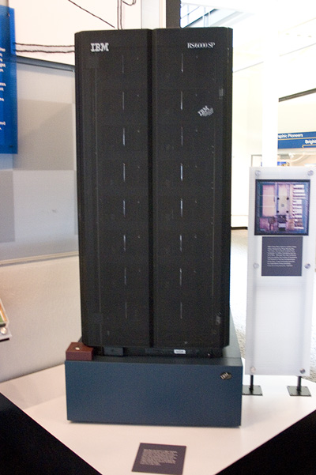
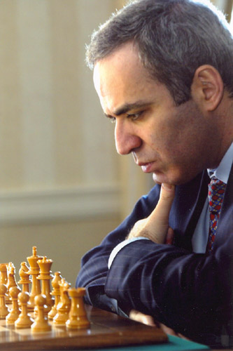
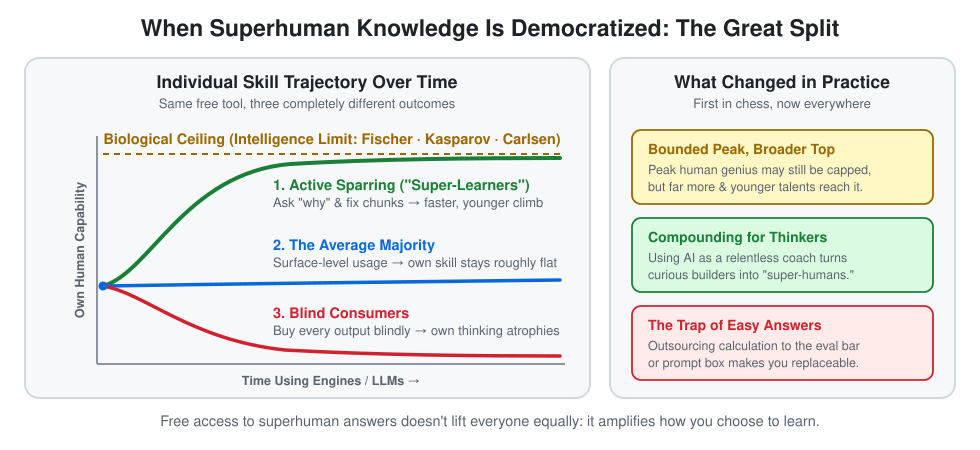
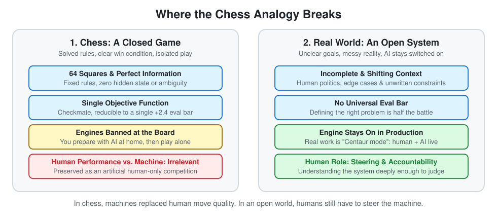

# 2026-W47: What Chess Engines Teach Us About LLMs

*Published: 2026-11-20*

## Intro

Everyone is currently debating what Large Language Models (LLMs) will do to human skill and intelligence. Will they turn everyone into a one-person powerhouse, or will they make us lazy, shallower, and eventually replaceable?

As an AI Solution Architect who also likes to play chess, I keep coming back to a simple thought: **we don't have to guess completely in the dark, because chess already ran a version of this experiment decades ago.**

Not with LLMs, of course, but with chess engines that surpassed every human on earth and then became freely available to anyone with a computer. Watching what happened to chess players since then is one of the sharpest mental models I know for what is unfolding with AI right now.

## How Engines Changed Chess

In May 1997, beating world champion Garry Kasparov required IBM's Deep Blue, a specialized supercomputer cabinet built by an entire research team. Just six years later, in 2003, programs like Deep Junior were already holding Kasparov to a 3:3 tie on far more modest hardware. Not long after that, open-source engines like Stockfish arrived: free software capable of crushing any human who ever lived, running effortlessly on a laptop or smartphone.

  <figure class="photo-card" style="margin: 0;">
    
    <figcaption><strong>1997:</strong> IBM's Deep Blue cabinet at the Computer History Museum. Once a specialized supercomputer built to beat one world champion, soon outclassed by free software on any laptop. <em>(Photo: <a href="https://commons.wikimedia.org/wiki/File:Deep_Blue.jpg" target="_blank" rel="noopener">James the photographer</a>, CC BY 2.0)</em></figcaption>
  </figure>
  <figure class="photo-card" style="margin: 0;">
    
    <figcaption><strong>2003:</strong> Garry Kasparov facing the chess program Deep Junior, near the end of the era when a human world champion could still hold a match against a machine. <em>(Photo: <a href="https://commons.wikimedia.org/wiki/File:Kasparov-29.jpg" target="_blank" rel="noopener">Owen Williams / The Kasparov Agency</a>, CC BY-SA 3.0)</em></figcaption>
  </figure>

On paper, this was the ultimate **democratization of elite knowledge**. In earlier decades, reaching the top practically required growing up near a Soviet chess school, having access to grandmaster seconds, and collecting rare opening bulletins. Suddenly, a talented kid in a small town in India, Norway, or anywhere else had a 3500+ Elo sparring partner sitting in their bedroom around the clock for free.

Naively, you might expect that universal access to perfect answers lifted *everyone's* level dramatically. In reality, something much more interesting happened:

1. **The absolute human peak still looks bounded:** Human intelligence, calculation depth, and memory have biological limits (much like the bounded dimensions I wrote about in [W44](2026-w44.md)). Even after decades of engine preparation, people still seriously debate whether Magnus Carlsen is the greatest player of all time, or whether Bobby Fischer or Garry Kasparov reached a comparable peak in their own eras. Very few humans ever get near that ceiling.
2. **Far more and much younger climbers reach the top tier:** What *did* change dramatically is the path up the mountain. Because geographic gatekeepers vanished, far more talents climb into the elite tier, and they reach grandmaster strength at astonishingly young ages.
3. **A flat average, and a new trap at the bottom:** Meanwhile, the average club player stayed roughly at the same level. And some players arguably got *worse* at thinking for themselves. When you review a game by staring straight at the evaluation bar (`+2.4`) and clicking through the engine's top line without calculating *why* your move failed, you buy the answer without building the intuition.

## The Analogy to LLMs

I see the exact same split happening right now with LLMs, except this time it isn't about a board game. It touches almost all of knowledge work.

In a sense, LLMs democratize knowledge even more radically than the internet did. The internet gave us access to the world's biggest library, which was already a massive leap, but you still had to know the right search terms, sift through ten articles, and translate general concepts onto your specific problem. LLMs remove most of that friction. You can describe a half-formed problem directly, ask follow-up questions, and get tailored explanations or working code within seconds.

Just like chess engines, however, easier access to answers doesn't make everyone smarter. Instead, it amplifies how you choose to work:

- **Active Sparring ("Super-Humans"):** A small group uses LLMs to accelerate their own understanding. They question assumptions, explore unfamiliar domains faster, expose flaws in their own architectures, and ship things solo that previously needed a whole team (something I touched on in [W45](2026-w45.md)). They don't just get better output; *they* become far more capable.
- **The Average Majority:** Many people use AI casually for minor conveniences, like summarizing a thread or polishing an email, without changing how deeply they engage with hard problems. Their underlying skill stays roughly flat.
- **Blind Consumers:** Then there is the group that lets the AI do all the thinking. They paste a task in, copy the answer out, and accept every generated line of code or slide bullet at face value. Short term, it looks productive. Long term, their own judgment dulls, and anyone whose sole value is acting as a human copy-paste bridge between a prompt and a document is making themselves redundant.

## Where the Chess Analogy Breaks

Of course, analogies only carry so far, and this one breaks at an important boundary.

Chess is a closed, tiny universe: 64 squares, fixed rules, complete information, and a single unambiguous goal. In terms of pure move quality, humans play no role at the top anymore. Competitive chess survives only because we deliberately ban engines during tournament games, the same way we don't allow cars in a footrace.

Real life and real engineering look very different:

- **Open world, messy context:** Business and engineering problems rarely have complete information or clean rules. Unspoken constraints, human incentives, legacy systems, and shifting trade-offs live outside any neat prompt context.
- **No single evaluation bar:** Nobody hands you an objective `+2.4` score for a software architecture or a company strategy. Half the work is figuring out which problem is actually worth solving in the first place.
- **The engine stays switched on:** In a chess tournament, you prepare with Stockfish at home and then sit down at the board alone. In the real world, AI stays switched on in production. Our daily work is much closer to *Centaur chess* (human plus machine operating as a team) than classical over-the-board play.

In that open world, humans will hopefully still matter for quite a long time. Not as raw move generators, though, and only if we understand the underlying system deeply enough to steer the AI, verify its output against reality, and carry responsibility when things go wrong.

## Closing Words

Funnily enough, both sides of this story recently met on my own chessboard.

My chess rating sits around ~2050 (DWZ/Elo), and I've been trying to figure out what is holding me back from the next step. A classical chess engine is great at pointing out concrete tactical blunders, showing me immediately where an evaluation drops from `+0.8` to `-1.2`, yet it never explains the cognitive habit behind those mistakes.

So I recently used an LLM to analyze patterns across my errors instead. The diagnosis that came out of those sessions was eye-opening: **I'm missing specific positional chunks.** In cognitive psychology and chess research, strong players don't just calculate deeper move trees; they recognize recurring piece and pawn configurations stored as compressed mental "chunks" in long-term memory. In certain structures, I simply lack those stored reference patterns and burn too much energy trying to calculate from scratch.

Whether consciously training those missing chunks actually makes me a stronger player is something I won't know for at least one or two years. I barely play classical over-the-board tournament games at the moment, so it will take a long time before my official rating catches up with whatever changes in my head.

Still, I love that loop as a reminder for everything else I build and learn. Having a superhuman engine on your desk is a gift, as long as you never let it replace your own thinking. Use it to find your missing chunks, not to stop learning.
