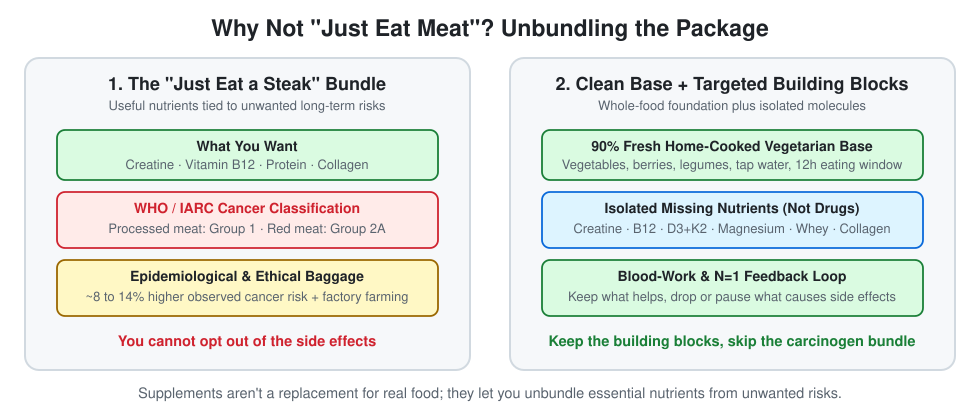
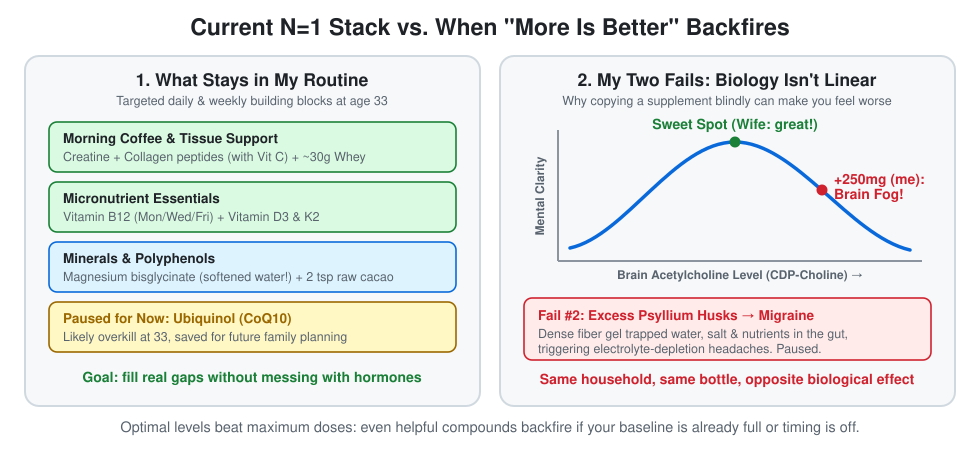

# 2026-W48: Longevity, Supplements, and My Two Fails

*Published: 2026-11-27*

## Intro

My deep dive into longevity and supplements started two jobs ago on the highway between Holzkirchen and Ingolstadt. Once a week I had to commute roughly 100 km each way. Taking the train was possible on paper, yet driving my freshly leased VW ID.3 (which I am actually about to return in the next few weeks) was much faster. Since I couldn't read behind the wheel, I turned to podcasts on Spotify so the drive wouldn't feel like wasted time.

Eventually, I stumbled onto the [Huberman Lab podcast](https://www.hubermanlab.com/) by [Andrew Huberman](https://en.wikipedia.org/wiki/Andrew_D._Huberman), especially his shorter *Essentials* episodes. One guest who immediately hooked me was Harvard geneticist [David Sinclair](https://en.wikipedia.org/wiki/David_A._Sinclair). I have always secretly felt that I don't *have* to die of natural causes, so Sinclair's core thesis, treating **aging itself as a curable disease**, hit home immediately.

I listened to his audiobook [*Lifespan: Why We Age and Why We Don't Have To*](https://en.wikipedia.org/wiki/Lifespan:_Why_We_Age_%E2%80%93_and_Why_We_Don%27t_Have_To) right away and even gifted a copy to my mother (though I am still not entirely sure how much of it she actually read), since many of the interventions in the book matter most later in life. Still, it left me with an obvious question: **What makes sense to do right now in my early thirties?**

## Fasting, Blood Work, and Iterative Course Corrections

My first practical step didn't cost a cent: **fasting**. Today I keep daily intermittent fasting fairly relaxed by simply skipping breakfast and eating between noon and midnight. On top of that, I aim for one full fasting day per month (10 times per year is the target) to trigger cellular cleanup via autophagy, hitting a personal record of **32 hours** recently. Pushing past 72 hours would be even more fascinating because prolonged fasting forces parts of the immune system to break down and rebuild old T cells, including regulatory T cells (Treg), whose role in peripheral immune tolerance won the [2025 Nobel Prize in Physiology or Medicine](https://www.nobelprize.org/prizes/medicine/2025/summary/) and also ties into allergies (though neither my wife nor I have any). Multi-day fasting is a rabbit hole for its own post, though.

Speaking of my wife: we are both 33 (well, she turns 33 tomorrow, happy birthday `<3`!). When we finally visited a new general practitioner for travel vaccinations after three years without a family doctor following our move, he offered to run the preventative blood check-up right away even though Germany's standard statutory screening (*Check-up 35*) usually starts at 35.

Analyzing those lab results together with an LLM ("Chattie") turned up three super useful course corrections:

1. **Thyroid & fasting aren't unisex:** My labs showed mild subclinical hypothyroidism, and my wife was right on the borderline. Since I feel energetic and fit, digging into the literature showed that slightly downregulated thyroid activity is a classic metabolic adaptation to fasting and is even observed in long-lived populations. For a woman planning to have children in the coming years, however, even borderline low thyroid values are a strict no-go. So my wife dropped fasting completely until our future kids chapter is done.
2. **Half-marathon "skinny fat" drift:** After shifting all my training from calisthenics to running for last month's half marathon, I lost weight on the scale yet showed slightly elevated glycerol markers and a subtle drift toward becoming skinny fat. At 185 cm and roughly 90 kg, my protein intake was simply too low while running high mileage. That brought **whey protein** back into my kitchen and pushed me back toward strength training via a modified *Grease the Groove* routine (more on that in an upcoming post).
3. **"Normal" vs. optimal blood sugar:** My glucose markers sat inside the standard clinical reference range, yet Chattie rightly pointed out that clinical "normal" just means average in an aging society, not optimal if your goal is staying healthy for decades. Looking at my habits, I realized I was eating way too many apples and bananas, so I shifted much more toward **berries and vegetables**.

## Why Not Just Eat a Steak?

Before listing any powders or capsules, one thing is important to clarify: **supplements are not a patch for a trash diet.** My wife and I cook roughly **90% of our main meals fresh from scratch**, even during busy workweeks, which probably puts our baseline diet comfortably inside the healthiest 10%. We also drink German **tap water**, which is more strictly controlled than bottled supermarket water. And the supplements I take aren't pharmaceuticals or sketchy hormone hacks; they are simply isolated micronutrients and building blocks that the body needs in sufficient amounts without messing with endocrine feedback loops.

Still, whenever supplements come up, someone inevitably drops the classic line: *"Why take creatine and B12 pills? Just eat a balanced diet with meat!"*

As a vegetarian, my pragmatic answer used to be simple: yes, eating plenty of meat would cover my **creatine** and **vitamin B12** (and maybe some **collagen**, which I know isn't vegetarian, though upcycling slaughter byproducts doesn't bother me ethically), except meat comes bundled with downsides I don't want to buy.

What I only learned this week made that intuition feel like sweet vindication: the [World Health Organization (WHO / IARC)](https://www.who.int/news-room/questions-and-answers/item/cancer-carcinogenicity-of-the-consumption-of-red-meat-and-processed-meat) officially classifies **processed meat as Group 1 (carcinogenic to humans)** and **red meat as Group 2A (probably carcinogenic)**, with large observational cohorts reporting roughly **8 to 14% higher cancer risk** among high meat consumers. Both my father and my grandfather died of cancer. If I can unbundle the exact molecules I want in pure, tested form while leaving the carcinogenic baggage on the shelf, why on earth wouldn't I?

## What Actually Stays in My Stack

After getting hooked on the topic, I picked up [Bas Kast's](https://de.wikipedia.org/wiki/Bas_Kast) recent book *Der Vitaminkompass* (2026) at the library. Overall it is a great evidence-based resource, especially the nutrient compass in the appendix, even if parts of it feel written more for older omnivores than a 33-year-old vegetarian (and it annoyed me a bit that he still recommends eating potentially contaminated fish twice a week instead of just taking clean **algae oil** for omega-3).

I worked through his entire nutrient appendix systematically with an LLM, sorting out what applies to us and realizing how much in nutrition science is still genuinely uncertain. Right now, this is the stack that survived (most of it shared with my wife, and constantly re-evaluated):

- **Creatine monohydrate (daily, stirred into morning coffee):** Supports muscular ATP regeneration and cognitive energy; virtually absent in a vegetarian diet.
- **Collagen peptides (daily):** For joints, tendons, and skin, taken either in coffee or alongside orange juice / vitamin C to support collagen synthesis.
- **Whey protein (~30 g daily, just me):** Easy insurance to hit protein targets at ~90 kg without force-feeding quark all evening.
- **Raw, non-alkalized cacao powder (2 tsp daily, just me):** Unprocessed (*non-Dutched*) cacao retains the polyphenols and flavanols that standard baking cocoa destroys.
- **Vitamin B12 (Monday, Wednesday, Friday):** Non-negotiable without meat.
- **Magnesium bisglycinate (daily):** Our house runs a **water softening system** (*Entkalkungsanlage*), which is fantastic for protecting household appliances from limescale, yet mediocre for taste and strips natural minerals like magnesium and calcium out of our tap water.
- **Vitamin D3 + K2:** Standard baseline for central European winters and indoor office work.
- **Ubiquinol / CoQ10 (currently paused):** Paused for myself because a healthy 33-year-old usually synthesizes plenty, though it stays on the shelf because cellular mitochondrial support becomes super important once kids are on the horizon.

## My Two Fails: CDP-Choline and Psyllium Husks

Self-experimentation only stays honest if you also talk about what backfired. Two popular compounds went straight onto my pause list recently:

1. **CDP-Choline (Citicoline) and unexpected brain fog:** My wife tolerates CDP-choline great and loves the mental clarity. When I took a modest **250 mg** dose, however, it gave me unmistakable **brain fog**. Why? CDP-choline crosses the blood-brain barrier and raises **acetylcholine**. Like most neurotransmitters, acetylcholine follows an **inverted-U curve**: if your baseline is low, adding choline sharpens focus; if your baseline cholinergic tone is already high (from genetics or diet, such as eggs and dairy), pushing it higher tips you over the peak into sluggishness, mental fog, or low mood. I dropped it immediately and might only re-test taking it every second or third day later on.
2. **Psyllium husks (*Flohsamenschalen*) and the electrolyte migraine:** Psyllium husks are praised everywhere for gut health and blood sugar buffering. Early on, I carelessly took way too much at once and ended up with a brutal **migraine**. After playing detective for days, the mechanism clicked: psyllium forms a thick mucilage gel in the intestine. In excessive amounts or poorly timed around meals, that viscous gel physically traps water, sodium, and micronutrients, blunting absorption and pulling electrolytes into the gut. I am already prone to migraines whenever my salt or electrolyte levels dip, and since I still haven't found a daily timing window where psyllium doesn't collide with meals or supplements, it stays paused too.

## Closing Words

My long-term bet is simple, even if it sounds slightly sci-fi: stay as healthy, strong, and disease-free as humanly possible for the next few decades, and give medical progress maximum runway to figure out the rest of longevity (*longevity escape velocity*, if we're lucky).

Getting there doesn't mean swallowing twenty random biohacker pills. It means cooking real food 90% of the time, running occasional blood work, filling genuine biochemical gaps with clean building blocks, and listening closely enough to your own body to ditch anything that gives you brain fog or migraines, even if a bestselling book or your partner swears by it.

*Disclaimer: Not medical advice, obviously. Just N=1 notes from a 33-year-old vegetarian trying to stay around for a very long time.*

